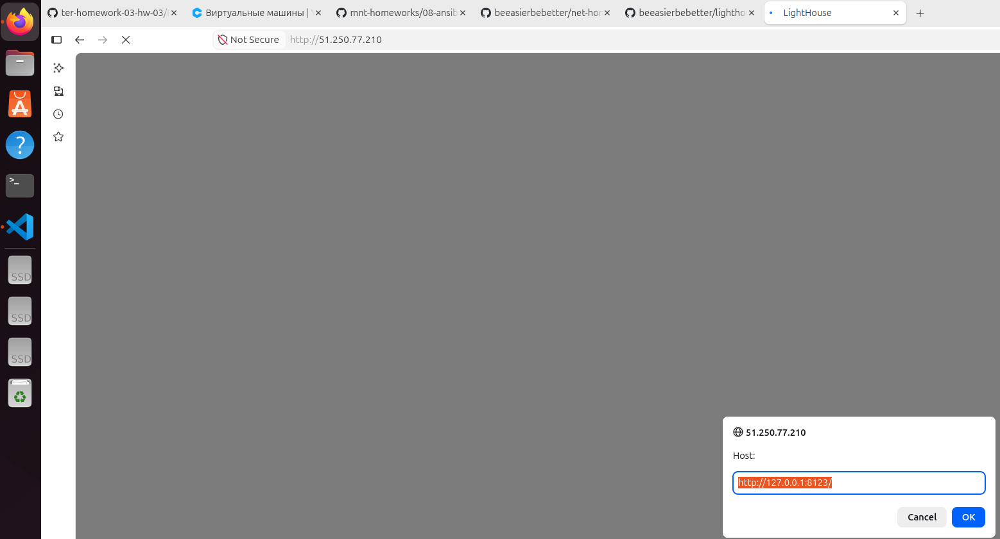

# Домашнее задание к занятию 4 «Работа с roles» - Котуков Евгений

## Подготовка к выполнению

1. * Необязательно. Познакомьтесь с [LightHouse](https://youtu.be/ymlrNlaHzIY?t=929).
2. Создайте два пустых публичных репозитория в любом своём проекте: vector-role и lighthouse-role.
3. Добавьте публичную часть своего ключа к своему профилю на GitHub.

## Основная часть

Ваша цель — разбить ваш playbook на отдельные roles.

Задача — сделать roles для ClickHouse, Vector и LightHouse и написать playbook для использования этих ролей.

Ожидаемый результат — существуют три ваших репозитория: два с roles и один с playbook.

**Что нужно сделать**

1. Создайте в старой версии playbook файл `requirements.yml` и заполните его содержимым:

   ```yaml
   ---
     - src: git@github.com:AlexeySetevoi/ansible-clickhouse.git
       scm: git
       version: "1.13"
       name: clickhouse
   ```

2. При помощи `ansible-galaxy` скачайте себе эту роль.
3. Создайте новый каталог с ролью при помощи `ansible-galaxy role init vector-role`.
4. На основе tasks из старого playbook заполните новую role. Разнесите переменные между `vars` и `default`.
5. Перенести нужные шаблоны конфигов в `templates`.
6. Опишите в `README.md` обе роли и их параметры. Пример качественной документации ansible role [по ссылке](https://github.com/cloudalchemy/ansible-prometheus).
7. Повторите шаги 3–6 для LightHouse. Помните, что одна роль должна настраивать один продукт.
8. Выложите все roles в репозитории. Проставьте теги, используя семантическую нумерацию. Добавьте roles в `requirements.yml` в playbook.
9. Переработайте playbook на использование roles. Не забудьте про зависимости LightHouse и возможности совмещения `roles` с `tasks`.
10. Выложите playbook в репозиторий.
11. В ответе дайте ссылки на оба репозитория с roles и одну ссылку на репозиторий с playbook.

---

### Как оформить решение задания

Выполненное домашнее задание пришлите в виде ссылки на .md-файл в вашем репозитории.

---

## Решение:

## Репозитории Roles

- [Роль Vector](https://github.com/beeasierbebetter/vector-role) — тег `1.0.0`
- [Роль LightHouse](https://github.com/beeasierbebetter/lighthouse-role) — тег `1.0.0`

## Реализация

Playbook `site.yml` использует три роли: ClickHouse, Vector и LightHouse \
Роли и их версии указаны в `requirements.yml` \
Для ClickHouse используется внешняя роль версии `1.13`

Параметры ролей распределены между `defaults` и `vars`, конфигурация Vector формируется из шаблона

Зависимости LightHouse (Git и Nginx) устанавливаются через `pre_tasks` \
Конфигурация Nginx размещается через `tasks`, при её изменении handler перезагружает Nginx

Описание параметров Vector и LightHouse находится в README соответствующих ролей

## Запуск

```bash
ansible-galaxy role install -r requirements.yml
ansible-playbook site.yml
```

## Результат выполнения


